# ZMK-Config: Ferris Sweep mit Neo-Layout

ZMK-Firmware für einen Ferris Sweep (Shield `cradio`) mit zwei nice!nano v2,
auf Basis von ZMK v0.3.0. Das Layout orientiert sich an Neo und setzt voraus,
dass das Betriebssystem auf **Deutsch (QWERTZ)** eingestellt ist.

Die Grafik wird bei jeder Änderung an der Keymap automatisch von
[keymap-drawer](https://github.com/caksoylar/keymap-drawer) erzeugt.

## Dateien

| Datei | Inhalt |
| --- | --- |
| `config/cradio.keymap` | Keymap (Layer, Combos, Behaviors) |
| `config/cradio.conf` | Firmware-Einstellungen (Bluetooth, Akku, Sleep) |
| `config/west.yml` | ZMK-Version |
| `keymap_drawer.config.yaml` | Darstellung der Keymap-Grafik |

## Layer

- **Base**: Neo-Buchstaben. Doppeltipp auf U/A/O ergibt Ü/Ä/Ö. D, Del, J,
  Space und Backspace sind beim Halten Modifier.
- **Sym** (rechter Daumen halten): Zahlen und Sonderzeichen.
- **Func** (aus Sym über die Toggle-Taste, zurück mit der rechten Daumentaste):
  F-Tasten, Pfeile, Medien und Helligkeit.

Combos auf dem Base-Layer: **X + V** = Esc, **F + Q** = Enter.

Combos auf dem Func-Layer:

- **F1 + F2 + F3**: Bluetooth-Kopplung des aktuellen Profils löschen. Danach
  die Tastatur am Rechner entfernen und neu koppeln.
- **F6 + F7 / F7 + F8 / F8 + F9**: Bluetooth-Profil 1 / 2 / 3 wählen.

### Bluetooth-Profile

Jedes Profil speichert die Kopplung mit einem Gerät; getippt wird immer nur
auf dem Gerät des aktiven Profils. Die Auswahl bleibt nach Neustart und
Deep Sleep erhalten.

- **Neues Gerät koppeln**: ein freies Profil wählen und am Gerät koppeln.
- **Gerät wechseln**: Profil wählen, die Verbindung steht nach 1–3 Sekunden.
- **Kopplung löschen**: Profil wählen, dann F1 + F2 + F3.
- Ist die linke Hälfte per USB angeschlossen, geht die Eingabe dorthin.
## Firmware bauen und flashen

1. Änderungen pushen. GitHub Actions („Build“) baut die Firmware.
2. Im Workflow-Lauf die Artefakte herunterladen:
   - `cradio_left-nice_nano_v2`
   - `cradio_right-nice_nano_v2`
3. Hälfte per USB anschließen, Reset-Knopf zweimal schnell drücken und die
   passende `.uf2` auf das erscheinende Laufwerk kopieren.

## Bluetooth-Kopplungen zurücksetzen

Wenn sich nur der Rechner nicht mehr verbindet, reicht meist **F1 + F2 + F3**
auf dem Func-Layer (siehe oben).

Wenn sich die Hälften nicht mehr miteinander verbinden:

1. Das Artefakt `settings_reset-nice_nano_v2` auf **beide** Hälften flashen.
2. Danach wieder die normale Firmware auf beide Hälften flashen.
3. Beide Hälften gleichzeitig neu starten, damit sie sich koppeln.
4. Die Tastatur auf dem Rechner aus der Bluetooth-Liste entfernen und neu
   koppeln.
